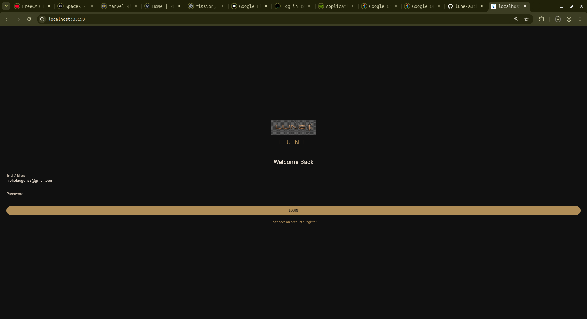
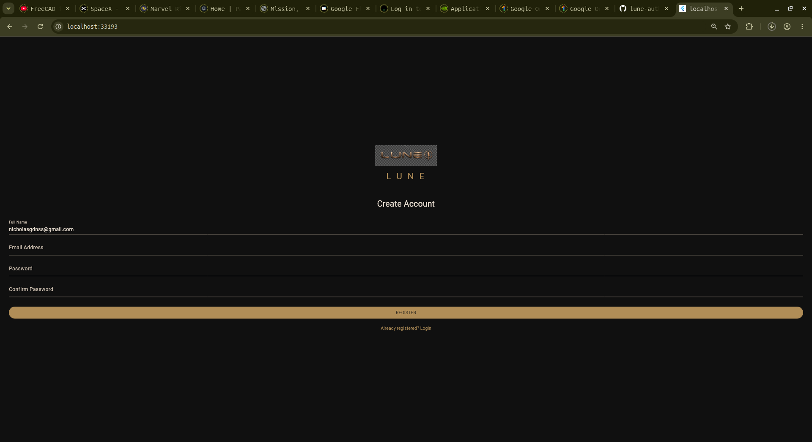
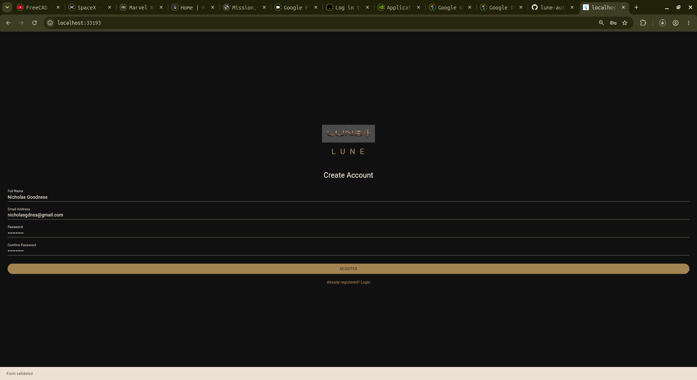

# LUNE Aerospace — Authentication Application

**A Flutter-based Login and Registration Interface**

---

## 1. Project Overview

LUNE Authentication is a mobile application interface developed using Flutter and Dart for LUNE Aerospace.

The application provides a user authentication interface consisting of login and account registration screens. It demonstrates the implementation of user input fields, form validation, screen navigation, and a consistent visual identity using Flutter's Material 3 design system.

The application adopts LUNE's black and bronze visual identity to maintain consistency with the company's branding.

This project serves as an initial implementation of the frontend authentication layer, with provisions for future backend integration.

## 2. Project Objectives

The primary objectives of this project are:

- To develop a functional login interface.
- To develop a user registration interface.
- To implement navigation between authentication screens.
- To implement basic input validation.
- To integrate company branding into the application.
- To demonstrate practical application development using Flutter and Dart.
- To establish a foundation for future authentication and database integration.

## 3. Technologies Used

| Technology | Purpose |
|---|---|
| Flutter | Cross-platform application development |
| Dart | Application programming language |
| Material 3 | User interface design system |
| Android Studio | Development environment |
| Git | Version control |
| GitHub | Source code hosting |

## 4. Application Features

### 4.1 Login Interface

The login interface provides:

- Company branding and logo.
- Email address input.
- Password input.
- Basic email validation.
- Password length validation.
- Navigation to the registration interface.

### 4.2 Registration Interface

The registration interface provides:

- Full name input.
- Email address input.
- Password input.
- Password confirmation.
- Basic input validation.
- Password matching verification.
- Navigation back to the login interface.

### 4.3 User Interface

The application incorporates:

- Material 3 design principles.
- Black and bronze colour scheme.
- Responsive scrolling layout.
- Consistent input field styling.
- Interactive buttons and navigation.

## 5. Application Screenshots

The following sections provide visual evidence of the application's implementation.

### 5.1 Login Screen

<!-- Insert login screen screenshot below -->



*Figure 1: LUNE application login interface.*

### 5.2 Registration Screen

<!-- Insert registration screen screenshot below -->



*Figure 2: LUNE application registration interface.*

### 5.3 Form Validation

<!-- Insert form validation screenshot below -->



*Figure 3: Application input validation.*

## 6. Project Structure

The project follows Flutter's standard directory structure.

```text
lune_auth/
│
├── android/                 # Android platform configuration
│
├── assets/
│   └── images/
│       └── company_logo.jpg # LUNE company logo
│
├── lib/
│   ├── main.dart            # Main application code
│   └── screens/             # Screen directory
│
├── test/
│   └── widget_test.dart     # Widget testing
│
├── web/                     # Web platform configuration
│
├── analysis_options.yaml    # Dart analysis configuration
│
├── pubspec.yaml             # Project dependencies and assets
│
└── README.md                # Project documentation
```

## 7. Installation and Setup

### Prerequisites

The following tools are required:

- Flutter SDK.
- Dart SDK.
- Android Studio.
- Git.
- A compatible web browser or Android Emulator.

### Step 1: Clone the Repository

```bash
git clone https://github.com/YOUR_USERNAME/lune-auth.git
```

### Step 2: Navigate into the Project

```bash
cd lune-auth
```

### Step 3: Install Dependencies

```bash
flutter pub get
```

### Step 4: Run the Application

To run the application in a web browser:

```bash
flutter run -d web-server
```

Alternatively, to run on a configured Android device or emulator:

```bash
flutter run
```

## 8. Testing and Code Analysis

Flutter's development tools were used to verify the application.

### Static Code Analysis

```bash
flutter analyze
```

This command checks the application for potential programming errors and code-quality issues.

### Widget Testing

```bash
flutter test
```

This executes the automated widget tests to verify the expected application behaviour.

Both checks were successfully completed during development.

## 9. Input Validation

The application implements basic client-side validation.

| Input | Validation |
|---|---|
| Full Name | Must not be empty |
| Email | Must contain an @ character |
| Password | Minimum of six characters |
| Confirm Password | Must match the original password |

These checks provide basic input validation and do not constitute server-side authentication.

## 11. Future Improvements

Potential improvements include:

1. Integration with Firebase Authentication.
2. User account creation and management.
3. Email verification.
4. Password recovery functionality.
5. Secure session management.
6. Improved form validation.
7. Additional application screens.
8. Android application packaging and deployment.

## 12. Project Information

| Attribute | Details |
|---|---|
| Project Name | LUNE Authentication Application |
| Organisation | LUNE Aerospace |
| Framework | Flutter |
| Programming Language | Dart |
| Application Type | Authentication Interface |
| Version | 1.0.0 |
| Repository | GitHub |

## 13. Author

**Developed by:** NIKOLA

**Department:** Computer Science

---

*LUNE Aerospace — Engineering Beyond Boundaries.*
